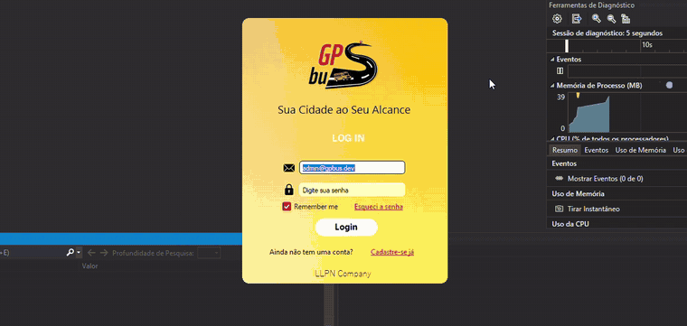
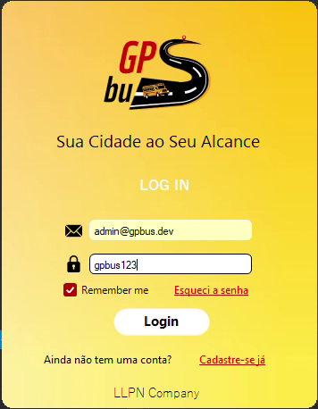
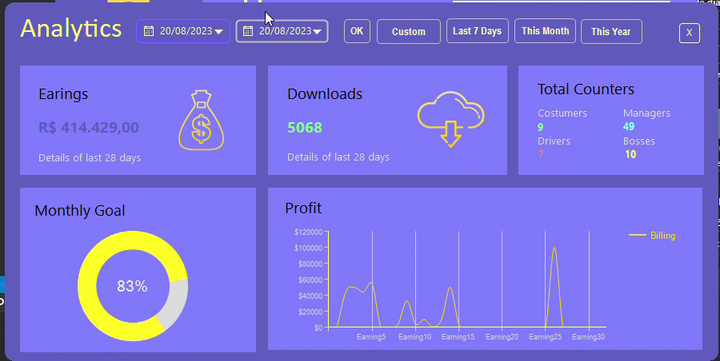
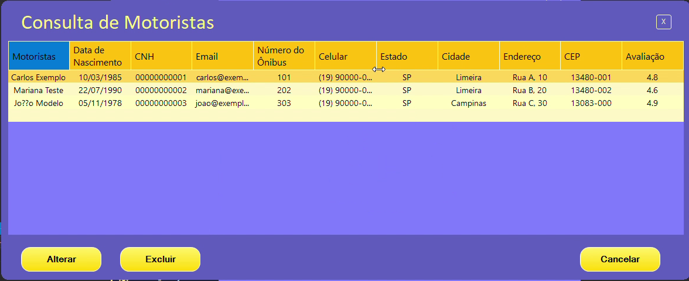
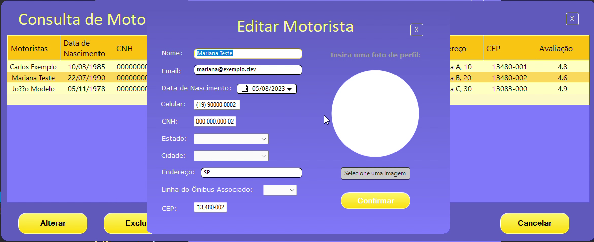
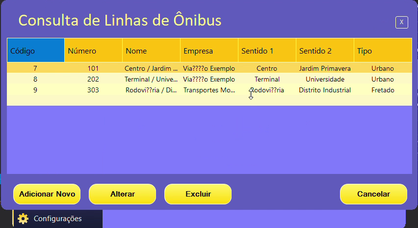
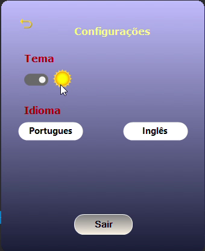
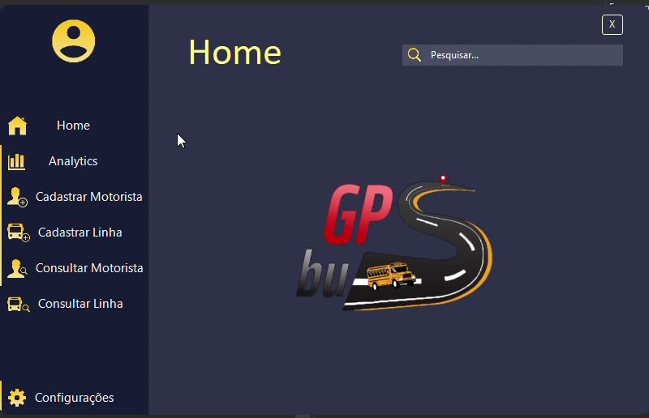
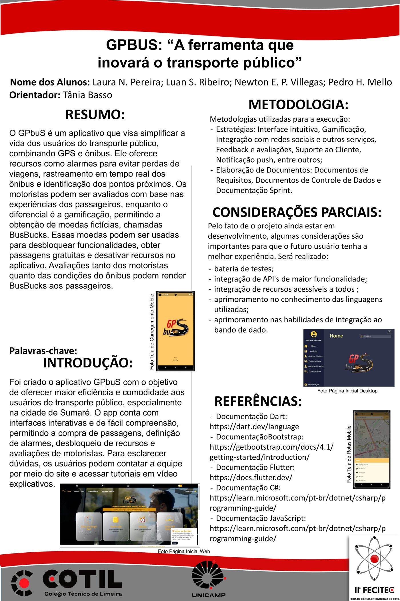

# GPbuS Desktop

Aplicativo desktop de gestão do **GPbuS**, um sistema multiplataforma de transporte público desenvolvido como Trabalho de Conclusão de Curso do Técnico em Desenvolvimento de Sistemas do **Cotil-Unicamp** (2023).

Enquanto os apps mobile atendem passageiros e motoristas, o desktop é o painel das **empresas de ônibus**: nele o administrador gerencia motoristas e linhas e acompanha indicadores da operação.

## Funcionalidades

- **Autenticação de administradores:** cadastro com foto de perfil, login com opção "lembrar-me" e recuperação de senha
- **Gestão de motoristas:** cadastro, consulta, edição e exclusão (CNH, ônibus, avaliação, contato e endereço)
- **Gestão de linhas:** cadastro, consulta, edição e exclusão (sentidos, horários de partida e empresa)
- **Analytics:** painel com gráfico de faturamento diário, contadores (downloads, clientes, motoristas) e acompanhamento da meta mensal, alimentado por uma planilha Excel
- **Personalização:** modo claro/escuro, seleção de idioma e tela de abertura (splash screen)

## Telas

| Login | Analytics |
|---|---|
|  |  |

| Consulta de motoristas | Edição de motorista |
|---|---|
|  |  |

| Consulta de linhas | Configurações | Modo escuro |
|---|---|---|
|  |  |  |

## Tecnologias

- C# e .NET Framework 4.7.2 (Windows Forms)
- MySQL (MySql.Data)
- Guna UI (componentes de interface, DLL incluída em `libs/`)
- EPPlus (leitura de planilhas Excel)
- System.Windows.Forms.DataVisualization (gráficos)

## Como executar

1. Abra `GPbuS.sln` no Visual Studio 2019 ou superior.
2. Restaure os pacotes NuGet (clique com o botão direito na solução → **Restaurar Pacotes NuGet**).
3. No MySQL Workbench, conectado ao seu MySQL local, execute `database/schema.sql` e depois `database/seed.sql`. Isso cria o banco `gpbus` com dados fictícios. Pela linha de comando, use `mysql -u root -p --default-character-set=utf8mb4 -e "source database/seed.sql"` para preservar os acentos.
4. Na pasta `GPbuS/`, copie `connectionStrings.example.config` para `connectionStrings.config` e preencha com os dados do seu MySQL (por exemplo, `Server=localhost;Database=gpbus;Uid=root;Pwd=sua_senha;`). Esse arquivo fica fora do Git.
5. Compile e execute (**F5**) e entre com o usuário de teste: `admin@gpbus.dev` / `gpbus123`. Para testar a recuperação de senha, use o CPF `000.000.000-00`.

A pasta `database/` contém a estrutura completa do banco do sistema, incluindo as tabelas usadas pelos apps mobile e pela API.

## Equipe

Projeto Integrador do Técnico em Desenvolvimento de Sistemas do Cotil-Unicamp, aprovado em novembro de 2023 e orientado pelo Prof. José Alberto Matioli. Desenvolvido por uma equipe de 4 alunos, com a seguinte divisão de frentes:

- **Luan Silva Ribeiro**: aplicativo desktop ([LinkedIn](https://www.linkedin.com/in/luan-silva-ribeiro))
- **Laura Nogueira Pereira** (gerente do projeto): site web
- **Newton Eduardo Pena Villegas**: aplicativo mobile
- **Pedro Henrique Sousa de Mello**: aplicativo mobile

O projeto foi apresentado na **II FECITEC (Feira de Ciência e Tecnologia)**.

O processo do projeto incluiu Business Model Canvas, termo de abertura, prototipação das interfaces no Figma, modelagem do banco em MySQL e apresentações avaliativas.

A revisão de segurança e a publicação deste repositório, em 2026, foram feitas por Luan Silva Ribeiro.

## Documentação e banner

- [Documentação completa do TCC (PDF)](docs/documentacao-gpbus.pdf): problema, objetivos, metodologia e o desenvolvimento das versões web, desktop e mobile
- [Banner apresentado na II FECITEC (PDF)](docs/banner-fecitec.pdf)

  

## Melhorias após o TCC

O código original (2023) passou por uma revisão de segurança e qualidade antes da publicação:

- **Senhas com hash:** as senhas passaram a ser salvas com PBKDF2-SHA256 e salt aleatório (`Seguranca.cs`). Contas antigas, com senha em texto puro, são migradas automaticamente no primeiro login.
- **Recuperação de senha segura:** antes bastava saber o e-mail de um administrador para trocar a senha dele. Agora é preciso confirmar o CPF cadastrado, a troca vale só para o e-mail verificado e a nova senha precisa ter pelo menos 8 caracteres.
- **SQL injection:** as consultas que montavam SQL concatenando texto passaram a usar parâmetros.
- **Credenciais fora do código:** os dados de acesso ao banco saíram do código-fonte e foram para um arquivo de configuração local, fora do controle de versão.
- **"Lembrar-me" sem senha:** o app guarda apenas o e-mail, e não mais a senha, nas configurações do Windows.
- **Mensagens de erro claras:** quando o banco está inacessível, o login informa um erro de conexão em vez de "senha inválida".
- **Analytics configurável:** o caminho da planilha deixou de ser fixo no código e passou para o `App.config` (chave `PlanilhaAnalytics`). Se a planilha não existir, a tela mostra os últimos dados salvos.

Quem já tinha criado o banco com uma versão anterior do `schema.sql` deve rodar `database/migracao_v2.sql`.
